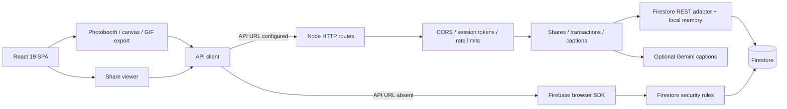

# S.O.L architecture and testing audit

**Date:** 3 November 2026 (Asia/Makassar). **Verdict: remediation required before production approval.**

The application has a reasonable small-product structure, but the current security and persistence boundaries are insufficient. The most serious findings are cross-session access to other users' records, client-controlled transaction completion, and successful API responses when database writes fail. The frontend also has confirmed accessibility barriers and performance concerns. Passing the existing tests does not establish production readiness.

This is a review and test deliverable. Application source, dependency versions, security rules, and deployments were not changed.

The subsequent [frontend/backend integration follow-up](INTEGRATION_AUDIT.md) adds real local HTTP checks and links the backend's dedicated audit. It confirms additional timestamp, webhook, amount, configuration and malformed-request behavior, including a crash reproduced in a disposable server process.

## Scope and evidence

- Frontend: this checkout at `a1c9bc286b8502a1a0a1f040af5cc66c2a53a2d3`.
- Backend: the connected GitHub repository [Snap-of-Love/S.O.L_Back_End](https://github.com/Snap-of-Love/S.O.L_Back_End/tree/9d05ea7e10c97448ebaa22f30f957d9c63e240c2), pinned to `9d05ea7e10c97448ebaa22f30f957d9c63e240c2`. Its source was downloaded to an isolated temporary directory for review and tests.
- Browser: local production build at `http://127.0.0.1:4173/`, Chrome 156 on macOS. Manual desktop and iPhone SE emulation (375 × 667) checks were performed. Camera permission was denied to exercise the failure path; no personal photographs or production records were created.
- Backend tests used in-process HTTP request/response objects and isolated in-memory stores. Database-failure probes replaced `fetch` with controlled responses; they did not contact Firestore. These tests establish code behavior, not deployment configuration.
- No deployed API address, production metrics, database credentials, cloud console access, or real-user performance dataset was supplied. Production infrastructure and actual deployed rules remain unverified.

Evidence is in [.audit/2026-11-03](.audit/2026-11-03/README.md) and the portable [evidence archive](AUDIT_EVIDENCE_2026-11-03.zip). Raw generated evidence is ignored locally so Tailwind does not interpret diagnostic HTML snippets as application classes; the archive preserves it for review and versioning. Source findings below reference frontend paths directly; `backend:` paths refer to the pinned backend repository.

## Architecture observed

React/Vite/Tailwind handle presentation; GSAP and Motion handle animation. Export processing runs in the browser. Node separates routes, services, guards, and persistence. There is no SQL database, ORM, or password-based user system in the reviewed code. There is also no authenticated ownership model for records. The direct Firestore path and the REST path implement different contracts and security controls.

The main client component, `src/components/Photobooth.tsx`, contains 1,922 lines and owns camera lifecycle, editing, exports, uploads, modals, and navigation. Extracting these responsibilities would make targeted verification easier, but repairing the security and data-integrity defects should come first.

## Verification results

| Check | Result | Meaning |
| --- | --- | --- |
| Clean dependency installation | Passed: `npm ci --ignore-scripts` | Lockfile installation succeeded; package lifecycle scripts were not executed. |
| Frontend production build | Passed | Vite bundles successfully; it does not run TypeScript checking. |
| Frontend `npm run lint` | Failed: 685 diagnostics | Mostly cascading missing React/JSX declarations; also missing `gifenc` declarations and implicit types. This is a typecheck script, not a full lint/security scanner. |
| Backend existing `npm test` | 9 tests passed | Isolated service and handler tests; no real Firestore, payment-provider, or browser-to-server verification. |
| Backend `npm run lint` | Failed: 6 diagnostics | Optional `headers` typing in the SDK and response-mock typing. Tested using shared installed tooling matching the declared TypeScript range; the backend has no lockfile. |
| Additional backend probes | 17 assertions completed | Includes reproduced failures and two positive controls: CORS restrictions and safe generic 500 responses. |
| `npm audit --json` | Failed vulnerability gate | 13 affected package entries: 10 high, 2 moderate, 1 low; 0 critical. Counts include transitive and build-tool packages. |
| Manual keyboard entrance | Failed | Tab focuses a button behind the overlay; Enter does not activate the launch prompt. |
| Camera-denial recovery | Failed | Start Session stays disabled; no actionable permission-recovery guidance. |
| Missing share ID | Passed | `/share` shows “No memory reference specified” and a return action. |

### Browser performance measurements

The retained Lighthouse 13.5.0 report used incognito, the mobile preset, simulated Slow 4G, and 4× CPU slowdown. It reported Performance **81**, Accessibility **89**, Best Practices **96**, and SEO **100**. These are diagnostic scores, not conformance or security certifications.

| Metric | Local observation | Assessment |
| --- | --- | --- |
| LCP | 4.148 seconds, Lighthouse simulated result | Above the 2.5-second good target. |
| CLS | 0.000155, Lighthouse result | Below the 0.1 target in this navigation. |
| INP | 240 ms, separate DevTools live interaction observation | Above the 200 ms good target for the small interaction sample. |
| FCP | 2.866 seconds | Loading improvement needed. |
| Total Blocking Time | 0 ms in Lighthouse navigation | Does not establish good INP during editing or export. |

The INP observation came from launching the app and entering the studio on the local desktop, without CPU/network throttling; it is not from the Lighthouse simulation. A later viewport change makes DevTools' displayed live LCP unsuitable as another benchmark, so that value is excluded.

Limitations: Lighthouse still warned about IndexedDB initialized at this origin. Its exported DevTools configuration contains `screenEmulation.disabled: true`; therefore treat this as a mobile-preset diagnostic run, not a controlled physical-phone benchmark. The entrance overlay was present during navigation. A preliminary extension-enabled run was discarded because injected extension scripts affected the results. These observations do not represent the 75th percentile of production visits or the camera/edit/export journey. The thresholds and field-versus-lab distinction follow [Google's Web Vitals guidance](https://web.dev/articles/vitals).

## Critical and high-priority findings

### A01 — Critical: anonymous sessions authorize cross-user access and deletion

**Evidence:** `backend:src/routes/sessions.routes.ts:45`, `src/middleware/security.ts:196`, `src/routes/shares.routes.ts:169`, and the DELETE branch near line 426; transaction list and detail/SSE routes have similar gaps.

`POST /v1/sessions` issues a token without identifying an owner. Verification accepts any valid session signature, without enforcing route permissions or ownership. In local tests, session B listed a share created by session A and deleted it. Session B also listed transactions. Transaction detail reads require no authentication, and SSE lacks an ownership check.

CORS correctly denied an unauthorized Origin, but requests without an Origin can still obtain tokens. That is normal for non-browser clients and demonstrates why CORS cannot supply authorization. Public photo lookup by a deliberately shared link can be intentional; collection-wide enumeration and deletion are different privileges.

**Required action:** define an owner or scoped capability for each record, distinguish anonymous creation from administration, restrict list routes, and enforce owner/delete permissions at every data access. Test two identities and denied cross-owner reads/writes. This matches the boundary described by [OWASP BOLA guidance](https://api-security.owasp.org/editions/2023/en/0xa1-broken-object-level-authorization/).

### A02 — Critical: transaction completion is client-controlled

**Evidence:** `backend:src/routes/transactions.routes.ts:306` and `src/services/transactions.service.ts:45`.

An anonymous session can submit a new transaction with `status: 'completed'`; the service accepts it. If `WEBHOOK_SECRET` is absent, an unsigned webhook can also mark a transaction completed. Both behaviors were reproduced locally. These records must not be treated as proof of payment.

**Required action:** create client-originated transactions as pending, derive amount/currency from a trusted contract, and accept completion only from an authenticated provider event. Require webhook secrets in production, verify signatures over the provider's original raw bytes, enforce valid state transitions, and deduplicate provider event IDs. The current verifier reserializes parsed JSON before verification, which can reject legitimate raw-body signatures; provider compatibility and replay handling need sandbox tests. The frontend support button currently sets a local convenience flag and does not verify payment.

### A03 — High: database failures return false success and updates never persist

**Evidence:** `backend:src/config/firebase.ts:148`, `:185`, and `:193`.

Creation writes to local memory before the network operation and ignores the Firestore response status. A mocked Firestore 403 still produced a successful create. `update()` modifies only local memory and performs no database write. A denied delete can still return true because a local record existed. A subsequent successful database read can even resurrect a supposedly deleted record.

**Required action:** use authenticated server persistence, validate every storage response, return appropriate 5xx failures, and perform real updates/deletes. Permit an in-memory adapter only when explicitly selected for tests/local development. Verify create/read/update/delete across a process restart and two server instances.

### A04 — High: Firestore and API contracts conflict

**Evidence:** frontend `firestore.rules:9`, `:43`, `:58`; `src/lib/api.ts:173`; `backend:src/config/firebase.ts:171`.

Share rules allow only image, layout, format, and creation time. Both clients can send `caption` and `expiresAt`, so those writes conflict with the checked-in rules. Transaction `note` also conflicts with its allowed fields. Backend Firestore REST calls supply an API key but no Firebase identity or Google IAM authorization; collection lists, updates, and deletes remain denied by these rules. Silent memory fallback hides those failures.

**Required action:** choose one authoritative server storage boundary, authenticate it with a least-privilege service identity, and align schemas. If browser writes remain, add authenticated owner rules and emulator tests for every field combination. A Firebase API key identifies a project; it is not a server authorization credential. See [Firebase's API-key documentation](https://firebase.google.com/docs/projects/api-keys).

### A05 — High: expiry and abuse controls are bypassable through direct Firestore

**Evidence:** `firestore.rules:44`, `:46`, `:59`, `:61`; `src/lib/api.ts:227`.

Single-document reads are public regardless of expiration. Client fallback checks expiry only after retrieving the data. Anonymous direct creates have no owner, application rate limit, or server-assigned timestamp. Transactions can be created with arbitrary status strings. REST protection alone cannot secure this parallel entry point.

**Required action:** remove unneeded direct writes, protect private transaction reads, enforce unexpired public-share access at the real boundary, and configure retention/deletion explicitly. No Firestore TTL field policy is present in the supplied configuration. The backend's 410 response hides expired content through that route; it does not prove data deletion.

### A06 — High: rate limits leave expensive routes open and trust spoofable headers

**Evidence:** `backend:src/middleware/rateLimit.ts:60`; caption and session routes.

Session creation and optional paid Gemini generation have no limiter. Repeated unauthenticated caption requests exceeded the configured write limit. Rotating `X-Forwarded-For` bypassed the per-IP share limit in a direct handler test. Whether that header is exploitable through the deployed ingress depends on proxy sanitization, which was not available.

**Required action:** trust only an explicitly configured reverse proxy; limit sessions, AI requests, reads and concurrent streams as appropriate; use shared bounded rate-limit storage and AI spending quotas. Test the deployed proxy's header behavior.

### A07 — High: production configuration fails open

**Evidence:** `backend:src/config/env.ts:46`, `src/middleware/security.ts:11` and `:205`.

Production configuration accepts missing API and webhook secrets. With no API secret, ordinary API authentication succeeds; session signing has a fixed fallback secret. This configuration behavior was reproduced, but actual production settings were not inspected.

**Required action:** fail startup when required production secrets, storage credentials, or allowed origins are absent/unsafe. Keep signing secrets and Gemini credentials server-only. Frontend `VITE_API_KEY` is compiled into public JavaScript; never place the backend master secret there. Public Firebase project configuration is a separate concern and is expected to be visible.

### A08 — High: known dependency advisories remain unresolved

**Evidence:** [npm-audit.json](.audit/2026-11-03/npm-audit.json), `package.json`, `package-lock.json`.

Affected package entries include Vite, Firebase/Firestore through `@grpc/grpc-js`, PostCSS, protobufjs, Browserslist, nanoid, source-map-js, and Babel. Several entries describe the same transitive chain; they are not 13 independently demonstrated browser exploits. Vite/PostCSS/Babel risks primarily involve development/build processing, and a Node gRPC advisory is not automatically reachable in the Firestore browser bundle.

**Required action:** update compatible tooling/transitives, assess shipped-browser versus server/build reachability, and rerun build/type/security checks. Do not blindly run `npm audit fix --force`: the audit suggests downgrading Firebase to 9.14.0, which is a major compatibility change. No dependency fixes were applied during this review.

### A09 — High: keyboard entrance and zoom barriers prevent accessibility approval

**Evidence:** `src/components/Preloader.tsx:111`; `index.html:6`; manual keyboard test.

The launch action is a click-only div without native keyboard activation. Background buttons remain focusable behind the overlay. The viewport disables user zoom. These are substantive barriers even though Lighthouse gives a relatively high accessibility score.

**Required action:** use a named native button, manage focus and background inertness while the overlay is active, permit zoom, and make the six-second introduction skippable. Verify WCAG 2.2 keyboard operation, focus visibility/order, and resizing/reflow manually. [WCAG 2.2](https://www.w3.org/TR/WCAG22/) is the conformance reference; this audit does not certify AA compliance.

## Additional findings and remediation

| ID / priority | Evidence and impact | Required action |
| --- | --- | --- |
| A10 / High | `backend:src/config/firebase.ts:222`: any cursor skips Firestore and pages local memory. A database-only cursor produced an empty page without a database request. | Implement stable database cursors using creation time plus document ID; test records created by other instances and tied timestamps. |
| A11 / Medium | Share/transaction routes check idempotency before an awaited create and save the result afterward. Concurrent identical keys produced two IDs. Stores are per process and keys are not owner-scoped. | Atomically reserve a scoped key in shared persistent storage; replay the same result across concurrency/restarts. Reuse a client key for retries of the same operation. |
| A12 / Medium | `backend:src/app.ts:75` parses the URL before the error boundary; the HTTP server discards handler promises. A malformed URL rejected outside the safe handler. | Parse inside the boundary and catch top-level handler rejections. Verify malformed raw requests through the actual ingress; a process crash was not induced in this audit. |
| A13 / Medium | Backend maps retain documents indefinitely; rate-limit client keys are never swept and idempotency entries expire only when looked up again. SSE events are local to each process, without heartbeat/backpressure handling. | Bound and evict caches, avoid retaining full photo records indefinitely, and use shared event delivery when scaling. Verify stream reconnects and instance routing. |
| A14 / Medium | `src/App.tsx:2` imports both routes eagerly. Production JS is 1,126,971 bytes, 327,946 gzip; CSS is 56,400 bytes, 10,299 gzip. Lighthouse found about 174 KiB of unused first-party JS at startup. | Lazy-load studio/export/Firebase code and the share route where appropriate. Set measured entry-bundle budgets. Build minification already works. |
| A15 / Medium | `index.html:28`: external font CSS and application CSS block rendering; Lighthouse estimated 450 ms potential savings. `Photobooth.tsx:234` eagerly fetches all five specimen images, approximately 1.38 MB combined. | Reduce font families/weights, consider self-hosting needed subsets, and defer offscreen specimen loading. Keep essential CSS early; do not defer all styles blindly. The entry script is a module, not a classic parser-blocking script. |
| A16 / Medium | `Photobooth.tsx:464` recomputes canvas previews and data URLs on every caption/grain change; animated mode builds five frames. Lens processing loops over pixels. `Lobby.tsx:57` updates React state on every mouse move. | Profile editor/export interactions on slower devices, schedule or debounce preview work, move heavy encoding/pixel processing to workers when justified, and isolate pointer updates. No editor INP measurement was possible without captures. |
| A17 / Medium | `Photobooth.tsx:1344`, `:1416`, `:1432`, `:1443`: labels are not associated with controls; the date toggle has no accessible name/state. Custom modal markup lacks dialog semantics/focus containment. | Associate labels, expose selection/switch state, use accessible dialogs, announce asynchronous status, and test screen-reader names and keyboard paths. Global Enter/Space capture handling should ignore focused controls. |
| A18 / Medium | `Preloader.tsx`, `Lobby.tsx`, `src/index.css`, `useMagnetic.ts`: no reduced-motion treatment; looping ambient/glitch motion and a six-second boot sequence remain. | Provide a reduced-motion path, skip/pause nonessential long animation where required, and verify effects against applicable WCAG motion/flashing criteria. Flashing thresholds and full target-size/contrast compliance remain unmeasured. |
| A19 / Medium | `Photobooth.tsx:249`: denied/unavailable camera errors are console-only. Manual denial left a blank preview and disabled Start Session. | Show a reason, browser permission recovery steps, and a retry/back action. Handle unsupported media APIs distinctly. |
| A20 / Medium | `src/lib/api.ts:157`, `SharePage.tsx:26`: requests have no deadline/cancellation; share effects do not reset old loading/error/data state or reject stale responses. Session resolution has no shared pending promise. | Add bounded requests, abort on ID change/unmount, reset states, validate responses, and deduplicate session acquisition. Test slow A followed by fast B, offline recovery, and expired sessions. Local state is sufficient; a new state library is not required. |
| A21 / Medium | API errors discard Problem Details and request IDs; upload errors are logged and shown as “Cloud feature unavailable,” while surrounding text can still say “Memory Composited & Linked.” | Map 401/403/413/422/429/5xx to actionable UI states, preserve the local download, and offer controlled retries. Carry safe request IDs into support diagnostics. |
| A22 / Medium | `SharePage.tsx:60` downloads without checking `res.ok` and opens unvalidated stored URLs on failure. Firestore rules permit any nonempty image string; backend validation is stricter. | Validate protocols/MIME in every path, enforce the same rules at storage, check download status, and remove unsafe navigation fallback. This is a potential URL/XSS sink; browser JavaScript execution was not demonstrated. No `innerHTML`, `dangerouslySetInnerHTML`, or `eval` sink was found in app source. |
| A23 / Medium | `Photobooth.tsx:608` converts PNG cloud exports to JPEG but submits the original `format`; `SharePage` largely guesses JPG/GIF by URL rather than honoring validated MIME. | Store actual MIME/format, and make cloud conversion explicit. Test PNG/GIF/file-extension consistency. |
| A24 / Medium | `index.html:11`, `App.tsx`, `Lobby.tsx`: generic canonical/OG metadata covers share pages, the landing page has no h1/main/nav landmarks, and the API OG route is not wired to generated `/share?id=` links. Its URL points to `https://snapoflove.id/?share=...`, which this router does not recognize as a share page. | Add semantic landmarks/headings, decide share indexing/privacy, and serve the appropriate metadata at the URL users actually share. Basic Lighthouse SEO 100 does not test this integration. |
| A25 / Medium | `package.json`, `tsconfig.json`: frontend types fail and build does not gate on them. No frontend test script or CI workflow is supplied. Backend has no dependency lockfile and also fails types. | Add missing declarations and resolve actual types, gate builds on type checking, add focused security/contract/browser tests, and lock backend dependencies. |
| A26 / Low | No frontend CSP/Permissions-Policy configuration is checked in; Vercel Analytics returns 404 in local preview. | Verify real hosting headers and configure least-privilege camera/CSP policies. Treat local analytics 404 as environment-specific, not proof of a production outage. |

## Infrastructure, database, and integration coverage

| Requested area | Audit conclusion / remaining evidence |
| --- | --- |
| Slow API endpoints | Firestore and Gemini calls lack timeouts. Memory list fallback sorts the entire collection; full base64 photos increase storage/response cost. No production latency diagnosis is possible without request traces. Measure per-route p50/p95/p99, external-call duration, concurrency, and error rates on representative data. |
| Indexes and N+1 | No per-row lookup loop or demonstrated N+1 pattern was found in the reviewed list methods. Backend declares four indexes; frontend declares none. Pagination is broken independently of indexing. Current initial createdAt ordering does not justify adding every declared composite index. Verify actual deployed indexes and query plans/scan costs after repairing the adapter. Exempt large photo fields from unnecessary indexing where appropriate. |
| Connection pooling | Firestore is called through Node's global HTTP fetch; there is no SQL connection pool to tune. Actual HTTP connection reuse, socket counts, timeouts and provider quotas were not observable. Measure these before introducing a custom HTTP agent or concurrency pool. |
| CPU/RAM | No server telemetry or deployment access was available, so no production utilization figures are claimed. Unbounded maps, large base64 records and unbounded SSE clients are concrete source-level capacity concerns. Monitor RSS/heap, CPU, event-loop delay, active sockets and external API concurrency under staging load. |
| SQL injection | Not applicable to the supplied Firestore architecture; there are no SQL query strings to parameterize. URL path pieces are encoded and API inputs have guards. If SQL is introduced later, use parameterized queries and server-side authorization. |
| Environment variables | `.env*` is ignored except the example. No actual application secrets were provided in this checkout. Public VITE variables must never contain private signing keys. Backend production validation fails open as documented above. Secret storage/rotation in the deployed platform was not inspected. |
| Data at rest | Photos need recoverable encryption, access control and deletion policies, rather than one-way hashing. Hash passwords if a password system is later introduced; none exists here. The SHA-256 idempotency fingerprint and HMAC session signatures do not encrypt stored photos. Verify provider encryption, backups, retention and key management; base64 is encoding. See [OWASP storage guidance](https://cheatsheetseries.owasp.org/cheatsheets/Cryptographic_Storage_Cheat_Sheet.html). |
| CORS | Positive tests passed for exact allowed Origin reflection and 403 for a disallowed Origin. Wildcard configuration is permitted and deployed values are unknown. No-Origin requests still require real authorization. Test actual preflights and error responses at the deployed ingress. |
| State synchronization | API client and local React state are simple enough for this app, but cancellation/race/error-state handling is incomplete. Firestore memory fallback and process-local SSE can disagree across instances. Server durability must be repaired before frontend caching can be considered authoritative. |
| Error abstraction | A forced service exception returned generic Problem Details 500 with a request ID and no injected secret/stack. The malformed-URL gap remains. The frontend does not consume the structured contract fully. Backend catch paths also suppress diagnostic details without an evident structured server log. |
| Storage size | Inline base64 consumes roughly one-third more space than binary. The API caps the entire JSON body at 1 MiB while image validation describes a 950 KB decoded ceiling, so large images may hit the body limit first. Firestore limits apply to the whole document, not only image length. Prefer bounded object-storage uploads plus metadata if sizes/use warrant it. [Firestore limits](https://firebase.google.com/docs/firestore/quotas) document the 1 MiB limit. |

## Required verification before release

1. Repair ownership, payment state authority, and durable persistence first. Add negative cross-owner tests and prove records survive restarts and multiple instances.
2. Run the Firestore emulator with the deployed rules/schema. Test allowed/denied get/list/create/update/delete, captions, expirations, timestamp trust, direct-client bypasses, and record-size boundaries. Verify deployed TTL deletion separately from link hiding.
3. Test webhook raw bytes, bad signatures, duplicate/out-of-order events and missing secrets using the actual provider sandbox. Verify amount precision; the current adapter truncates numeric values to integers while API validation accepts finite positive decimals.
4. Resolve type failures and dependency advisories, then rerun the existing tests plus audit probes. The supplied probe script intentionally confirms current defects; after repairs, replace those expectations with denied/safe behavior regression tests.
5. Complete a camera-approved test using non-sensitive fixture images: capture → retake → edit → JPG/PNG/GIF → cloud upload → open link → expire/delete. Exercise 401, 403, 404, 410, 413, 422, 429, timeout and 5xx UI states.
6. Perform full WCAG 2.2 AA keyboard, screen-reader, contrast, zoom/reflow, focus-obscuring, modal, target-size and motion checks. Inspect physical mobile devices and desktop browsers, including Safari camera/download/share behavior.
7. Repeat Lighthouse on a controlled browser/device profile and measure interaction traces through editing/export. Collect production real-user LCP/INP/CLS at p75 by device class. Navigation TBT and one sampled INP cannot establish field performance.
8. Use staging load tests and provider dashboards to establish API latency budgets, CPU/RAM limits, connection behavior, quotas, alerts, backups, and recovery. Confirm that health/readiness checks reflect storage readiness; the current health route returns a static OK without checking dependencies.

## Conclusion

S.O.L has a workable frontend and modular backend foundation, and its existing nine backend tests pass. However, the architecture currently permits cross-session record access and deletion, accepts client-declared transaction completion, and can report success without durable storage. The direct Firestore fallback further weakens consistency and bypasses REST-only controls. These are release-blocking design defects.

The frontend builds successfully, but keyboard access, zoom, camera-error recovery, request synchronization, and startup weight need improvement. Local measurements found LCP above the good target and a sampled INP of 240 ms, while CLS remained low. Dependency and type checks also fail their quality gates.

**Recommendation:** withhold production approval until authorization and persistence are repaired, then address accessibility and dependency failures and repeat the critical journey against real staging services. Production infrastructure, field performance, and full WCAG/OWASP compliance remain unverified; the available evidence does not support the previous document's blanket “GOOD” verdict.
