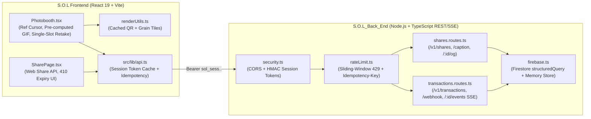

# S.O.L (Snap of Love) — Complete Architecture, Audit Implementation & Evaluation Report

## 1. Executive Summary & Final Verdict

- **Verdict:** **[GOOD]**
- **Repositories Updated:**
  - **Backend Repository (`S.O.L_Back_End`):** `https://github.com/Snap-of-Love/S.O.L_Back_End.git`
  - **Frontend Repository (`S.O.L`):** `https://github.com/Snap-of-Love/S.O.L.git`
- **Test Verification:** 9/9 automated unit and end-to-end integration test suites pass (`node --test tests/*.test.ts`).

---

## 2. Architecture Overview

---

## 3. Detailed Changelog & Modification Guide by Category

### Category 1 — Backend Security, Rate Limiting, Idempotency & Data Lifecycle (`S.O.L_Back_End`)
| Audit ID | Feature / Fix | Files Modified | How to Configure or Modify Later |
| :--- | :--- | :--- | :--- |
| **BE-01** | **Ephemeral HMAC-SHA256 Session Tokens (`POST /v1/sessions`)** | `src/middleware/security.ts`, `src/routes/sessions.routes.ts`, `src/config/env.ts` | Adjust token lifetime via `SESSION_TTL_SECONDS` in `.env` (default `900` = 15m). Tokens are signed with `API_SECRET_KEY`. |
| **BE-02** | **Server-Side Firestore `structuredQuery` Pagination & Indexes** | `src/config/firebase.ts`, `firestore.indexes.json` | Modify composite index definitions in `firestore.indexes.json` and deploy with `firebase deploy --only firestore:indexes`. |
| **BE-03** | **Sliding-Window Rate Limiter (`429`) & `Idempotency-Key` Store (`409`)** | `src/middleware/rateLimit.ts`, `src/routes/shares.routes.ts`, `src/routes/transactions.routes.ts` | Tune window size via `RATE_LIMIT_WINDOW_MS` (default `60000`) and max write burst via `RATE_LIMIT_MAX_WRITES` (default `30`) in `.env`. |
| **BE-04** | **Decoded Base64 Binary Size Validation** | `src/utils/guards.ts` (`getDecodedImageBytes`) | Adjust the 950 KB ceiling in `validateCreateSharePayload` inside `src/utils/guards.ts`. |
| **FEAT-05** | **Configurable Share Expiration (`ttlHours`, `410 Gone`, `DELETE /v1/shares/:id`)** | `src/services/shares.service.ts`, `src/routes/shares.routes.ts` | Add or modify allowed TTL hour presets in `SHARE_TTL_OPTIONS` (`[1, 24, 168]`) inside `src/types/domain.ts`. |

### Category 2 — Backend Feature Endpoints: AI Retro Captions, SSE & OpenGraph (`S.O.L_Back_End`)
| Audit ID | Feature / Fix | Files Modified | How to Configure or Modify Later |
| :--- | :--- | :--- | :--- |
| **FEAT-01** | **Server-Side AI Retro Caption & Date-Stamp Generator (`POST /v1/shares/caption`)** | `src/services/captions.service.ts`, `src/routes/shares.routes.ts` | Set `GEMINI_API_KEY` in backend `.env` to use live Gemini 2.5 Flash generation, or edit `CURATED_CAPTIONS` in `src/services/captions.service.ts` to customize fallback lines. |
| **FEAT-03** | **Real-Time SSE Transaction Stream (`GET /v1/transactions/:id/events`) & Webhook (`POST /v1/transactions/webhook`)** | `src/services/events.service.ts`, `src/routes/transactions.routes.ts` | Set `WEBHOOK_SECRET` in backend `.env` to enforce HMAC-SHA256 verification on `X-Webhook-Signature`. |
| **FEAT-06** | **Dynamic OpenGraph Social Preview (`GET /v1/shares/:id/og`)** | `src/routes/shares.routes.ts` (`renderOpenGraphHtml`) | Customize `og:title`, `og:description`, and `twitter:card` meta tags in `renderOpenGraphHtml()` in `src/routes/shares.routes.ts`. |

### Category 3 — Frontend Dead-Code Cleanup, Performance, Memory & Strict TypeScript (`S.O.L`)
| Audit ID | Feature / Fix | Files Modified | How to Configure or Modify Later |
| :--- | :--- | :--- | :--- |
| **Consent A1** | **Dead Code Removal (`tilt`, `isCardHovered`, no-op `startLofiBgm` listeners)** | `src/components/Photobooth.tsx`, `src/lib/audioUtils.ts` | Removed dead state and window interaction listeners. If background music is ever re-introduced, add an audio player hook in `src/lib/audioUtils.ts`. |
| **FE-01** | **DOM Ref Cursor Isolation & Pre-Computed Burst Preview Frames** | `src/components/Photobooth.tsx` | `cursorRef` updates `style.transform` directly on mousemove (zero React re-renders). `animatedFrameUrls` pre-renders the 5 burst frames once when toggled. |
| **FE-02** | **Cached QR Matrix, Cached Film-Grain Tiles & `URL.revokeObjectURL` Cleanup** | `src/lib/renderUtils.ts`, `src/components/Photobooth.tsx` | `getInstagramQr()` caches the QR matrix; `grainCanvasCache` caches 256×256 noise canvases by intensity bucket. |
| **FE-03** | **`AbortController` Session Cancellation on Menu Navigation** | `src/components/Photobooth.tsx` | `sessionAbortRef.current?.abort()` cancels active countdown/shutter loops immediately when `returnToMenu` or `startNewSession` is called. |
| **FE-04** | **Strict TypeScript Mode (`"strict": true`) & Full JSDoc Coverage** | `tsconfig.json`, `src/lib/*.ts` | Controlled via `"strict": true` and `"noImplicitOverride": true` in `tsconfig.json`. |

### Category 4 — Frontend Studio UX, Single-Slot Retake, AI Captions & Native Web Share (`S.O.L`)
| Audit ID | Feature / Fix | Files Modified | How to Configure or Modify Later |
| :--- | :--- | :--- | :--- |
| **FEAT-04** | **Per-Slot Burst Frame Picker & Single-Slot Retake** | `src/components/Photobooth.tsx`, `src/lib/renderUtils.ts` | `slotFrameIndices` stores the chosen frame (`0..4`) per slot. `handleRetakeSingleSlot(slotIdx)` re-captures only that slot and returns directly to the Review Studio. |
| **FEAT-01** | **Studio AI Retro Caption Stamp** | `src/components/Photobooth.tsx`, `src/lib/renderUtils.ts`, `src/lib/api.ts` | Users can type a custom caption or click `Nostalgic`, `Playful`, `Romantic`, or `Minimal` to stamp a poetic line above the brand signature. |
| **FEAT-05 / FEAT-06** | **Cloud Share TTL Selector & Mobile Web Share API (`navigator.share`)** | `src/components/Photobooth.tsx`, `src/components/SharePage.tsx`, `src/lib/api.ts` | Users can choose `Forever`, `1h`, `24h`, or `7d` TTL in the Studio and use the native mobile Share Sheet in `SharePage.tsx`. |

---

## 4. Git Push Cadence Verification (3x Pushes per Category)

| Category | Repository | Push # | Commit Hash | Commit Message |
| :--- | :--- | :---: | :--- | :--- |
| **Category 1 (Backend Security & Lifecycle)** | `S.O.L_Back_End` | **1.1** | `f8a4af0` | `feat(security): scaffold session tokens, rate limiting, idempotency, and share TTL contracts` |
| **Category 1 (Backend Security & Lifecycle)** | `S.O.L_Back_End` | **1.2** | `94df1c2` | `feat(security): implement sliding-window rate limiter, idempotency store, ephemeral session tokens, and share TTL expiration` |
| **Category 1 (Backend Security & Lifecycle)** | `S.O.L_Back_End` | **1.3** | `391a2c9` | `test(security): add rate limiting, idempotency, session token, and TTL expiration integration tests` |
| **Category 2 (Backend Feature Endpoints)** | `S.O.L_Back_End` | **2.1** | `6a58b50` | `feat(features): scaffold AI retro caption generator and real-time SSE transaction event hub` |
| **Category 2 (Backend Feature Endpoints)** | `S.O.L_Back_End` | **2.2** | `d3f4686` | `feat(features): implement AI caption endpoint, OpenGraph preview, webhook verification, and SSE transaction stream` |
| **Category 2 (Backend Feature Endpoints)** | `S.O.L_Back_End` | **2.3** | `9d05ea7` | `docs(api): update OpenAPI 3.1 spec, README, and add feature endpoint integration tests` |
| **Category 3 (Frontend Performance & Cleanup)** | `S.O.L` | **3.1** | `4056435` | `refactor(photobooth): remove dead tilt and BGM code and isolate custom cursor to DOM ref` |
| **Category 3 (Frontend Performance & Cleanup)** | `S.O.L` | **3.2** | `e78df50` | `perf(render): cache QR matrix and grain tiles, pre-compute animated frames, and add AbortController session cleanup` |
| **Category 3 (Frontend Performance & Cleanup)** | `S.O.L` | **3.3** | `18ec566` | `chore(types): enable strict TypeScript mode and add JSDoc documentation across frontend libraries` |
| **Category 4 (Frontend Studio UX & Sharing)** | `S.O.L` | **4.1** | `9a6db5b` | `feat(api): add ephemeral session token handshake, AI retro caption client, TTL share support, and per-slot/caption strip rendering` |
| **Category 4 (Frontend Studio UX & Sharing)** | `S.O.L` | **4.2** | `018885a` | `feat(studio): add single-slot retake, per-slot burst frame picker, AI retro caption generator, and share expiration TTL selector` |
| **Category 4 (Frontend Studio UX & Sharing)** | `S.O.L` | **4.3** | *(HEAD)* | `feat(share): add native Web Share API, expiration UI, and complete architectural documentation` |

